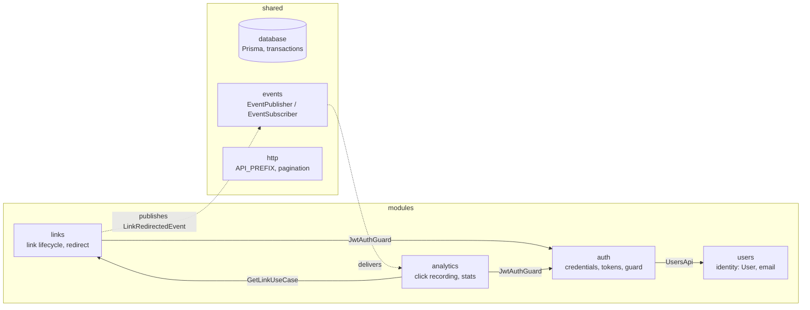
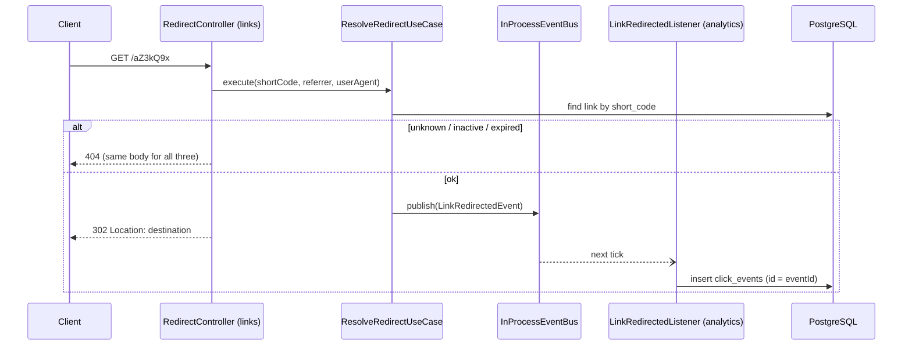
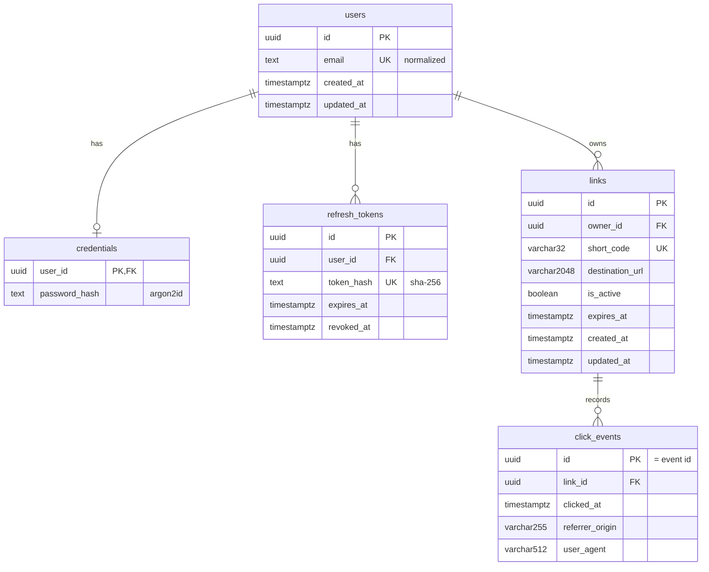

# URL Shortener API

A small, production-minded URL shortener API built as a **modular monolith**
with **Clean Architecture**. Users register, create short links (random codes
or custom aliases), manage their own links, share `/<code>` URLs that redirect
with HTTP 302, and read per-link click analytics.

The project is backend-first on purpose. It favours clear module boundaries,
explicit business rules and tests over a long feature list.

## Contents

- [Scope](#scope)
- [Technology stack](#technology-stack)
- [Architecture](#architecture)
- [Database schema](#database-schema)
- [API](#api)
- [Environment variables](#environment-variables)
- [Local setup](#local-setup)
- [Migrations and seed data](#migrations-and-seed-data)
- [Tests](#tests)
- [Design decisions and trade-offs](#design-decisions-and-trade-offs)
- [Known limitations](#known-limitations)
- [AI-assisted development log](#ai-assisted-development-log)

## Scope

In scope:

- Registration, login, JWT access tokens, refresh-token rotation and logout
- Create, list (paginated), read, update and delete your own short links
- Random 7-character codes (Nano ID) or custom aliases
- Activation/deactivation and expiry of links
- Public `GET /:shortCode` redirect (302)
- Click recording through an in-process event and per-link analytics

Not in scope: frontend, Redis, message brokers, microservices, QR codes,
custom domains, teams, geographic analytics.

## Technology stack

| Area | Choice |
|------|--------|
| Language / runtime | TypeScript (strict), Node.js 22+ (developed on 24) |
| Framework | NestJS 11 |
| Database / ORM | PostgreSQL 17, Prisma 7 (`@prisma/adapter-pg`) |
| Validation | class-validator, class-transformer |
| Auth | `@nestjs/jwt` + own guard; Argon2id password hashing |
| Short codes | `nanoid` v3 (CommonJS-compatible) |
| Rate limiting | `@nestjs/throttler` |
| Events | In-process event bus (`shared/events`) |
| Tests | Jest + Supertest |
| API docs | Swagger / OpenAPI (`@nestjs/swagger`) |
| Containers | Multi-stage `Dockerfile` (non-root), Docker Compose (`app` + `postgres`) |

## Architecture

### Modules



| Module | Owns | Public API to other modules |
|--------|------|-----------------------------|
| `users` | `users` table, email normalization | `UsersApi` (`create`, `findByEmail`) |
| `auth` | `credentials`, `refresh_tokens`; register/login/refresh/logout | `JwtAuthGuard`, `@CurrentUser()`, `TOKEN_VERIFIER` |
| `links` | `links` table, short codes, redirect | `GetLinkUseCase` (ownership-checked lookup), `LinkRedirectedEvent` |
| `analytics` | `click_events` table | — |

Dependency rules:

- A module never imports another module's repository or reads its tables.
  It uses the other module's exported public API, or subscribes to its events.
- No cycles: `analytics → links → auth → users`.
- `shared/` holds technical concerns only (database, events, HTTP helpers,
  config, error mapping). It contains no business rules.

### Layers inside a module

```text
interfaces/      HTTP controllers, request/response DTOs, event listeners
application/     use cases, ports (contracts), application models
domain/          entities, value objects, domain errors, repository contracts
infrastructure/  Prisma repositories, Argon2/JWT/Nano ID adapters
```

`interfaces → application → domain` and `infrastructure → domain`
contracts. The domain doesn't import NestJS, Prisma or HTTP. Use cases are
plain classes wired with `useFactory` in each `*.module.ts`. Business errors
extend `ApplicationError` with a `kind`. The global `AllExceptionsFilter` is
the only place that maps a kind to an HTTP status, and every error returns
`{ statusCode, error, message }`.

### Redirect and click flow



## Database schema



- Every foreign key is `ON DELETE CASCADE`.
- Indexes: `links(short_code)` unique, `links(owner_id, created_at)`,
  `click_events(link_id, clicked_at)`, `refresh_tokens(token_hash)` unique,
  `refresh_tokens(user_id)`.
- Uniqueness of email, short codes and refresh tokens is enforced by the
  database. The application never relies on check-then-insert.

## API

Swagger UI: **http://localhost:3000/api/docs** (when the app is running).

| Method | Path | Auth | Purpose |
|--------|------|------|---------|
| POST | `/api/v1/auth/register` | — | Register (201) |
| POST | `/api/v1/auth/login` | — | Access + refresh token |
| POST | `/api/v1/auth/refresh` | — | Rotate refresh token, new pair |
| POST | `/api/v1/auth/logout` | — | Revoke a refresh token (204) |
| POST | `/api/v1/links` | Bearer | Create link (random code or `alias`) |
| GET | `/api/v1/links?page&limit` | Bearer | List own links, newest first |
| GET | `/api/v1/links/:id` | Bearer | Get own link |
| PATCH | `/api/v1/links/:id` | Bearer | Update `destinationUrl`, `isActive`, `expiresAt` (`null` clears) |
| DELETE | `/api/v1/links/:id` | Bearer | Delete own link (204) |
| GET | `/api/v1/links/:id/analytics?page&limit` | Bearer | Click summary + paginated clicks |
| GET | `/:shortCode` | — | 302 redirect |

Status code conventions:

| Status | When |
|--------|------|
| 400 | Invalid input, including unknown fields and `null` where it has no meaning |
| 401 | Missing or invalid token; bad credentials (one message for unknown email and wrong password) |
| 404 | Unknown link, or another user's link (never 403); unknown, inactive or expired short code |
| 409 | Email taken; alias taken |
| 429 | Rate limit exceeded: auth routes 5/min, link creation 30/min, everything else 100/min per IP |

Pagination: `page` 1–10000 (default 1), `limit` 1–100 (default 20).

## Environment variables

Copy `.env.example` to `.env`. The app validates these at startup and refuses
to boot if one is invalid.

| Variable | Required | Default | Purpose |
|----------|----------|---------|---------|
| `PORT` | no | `3000` | HTTP port |
| `DATABASE_URL` | yes | — | PostgreSQL connection string |
| `JWT_SECRET` | yes | — | HMAC secret, at least 32 characters |
| `JWT_EXPIRES_IN` | no | `15m` | Access-token lifetime (`<n>ms\|s\|m\|h\|d`) |
| `JWT_ISSUER` | yes | — | `iss` claim, verified |
| `JWT_AUDIENCE` | yes | — | `aud` claim, verified |
| `REFRESH_TOKEN_TTL_DAYS` | no | `7` | Refresh-token lifetime |
| `PUBLIC_BASE_URL` | no | `http://localhost:3000` | Base of `shortUrl` in responses |
| `POSTGRES_USER` / `POSTGRES_PASSWORD` / `POSTGRES_DB` / `POSTGRES_PORT` | compose only | — | Used by `docker-compose.yml` to create the database |

`.env` is gitignored, and `.env.example` contains placeholders only.

## Local setup

Prerequisites: Node.js 22+ and npm, Docker with Docker Compose.

From a clean checkout:

```bash
cp .env.example .env               # then set JWT_SECRET (≥ 32 chars) and the DB password
npm ci
docker compose up -d postgres      # PostgreSQL 17 with a healthcheck and a named volume
npx prisma migrate deploy          # apply all migrations
npx prisma generate                # generate the Prisma client into src/shared/database/generated
npm run start:dev                  # API on http://localhost:3000, Swagger at /api/docs
```

Production-like run, with the API in a container as well:

```bash
cp .env.example .env               # set JWT_SECRET and the DB password
docker compose up --build          # postgres (healthcheck) → app: migrate deploy → node dist/main
```

- `app` waits for Postgres to report healthy. It then applies migrations
  (`prisma migrate deploy`) and starts on `http://localhost:${PORT:-3000}`.
- Its `DATABASE_URL` points at the `postgres` service. Every other value
  comes from `.env` at run time.
- The image contains no secrets. `.dockerignore` keeps `.env` out of the
  build context.
- The runtime stage has production dependencies and `dist/` only, and runs
  as the non-root `node` user.

Without Docker for the API:

```bash
npm run build
npm run start:prod
```

Quick check:

```bash
curl -s -X POST localhost:3000/api/v1/auth/register \
  -H 'content-type: application/json' \
  -d '{"email":"me@example.com","password":"correct-password"}'
TOKEN=$(curl -s -X POST localhost:3000/api/v1/auth/login \
  -H 'content-type: application/json' \
  -d '{"email":"me@example.com","password":"correct-password"}' | jq -r .accessToken)
curl -s -X POST localhost:3000/api/v1/links -H "authorization: Bearer $TOKEN" \
  -H 'content-type: application/json' -d '{"destinationUrl":"https://example.com"}'
curl -i localhost:3000/<shortCode>   # 302
```

Stop everything with `docker compose down`. Add `-v` to also delete the
database volume.

## Migrations and seed data

```bash
npx prisma migrate deploy   # apply pending migrations (what deployments use)
npx prisma migrate dev      # local only: create a migration from schema changes
npx prisma generate         # regenerate the client after any schema change
```

Migrations live in `prisma/migrations/`. `prisma db push` is not used.

There is no seed script. The API needs no reference data, so register a user
through the API instead.

## Tests

```bash
npm test             # unit tests: no database, ports mocked
npm run test:e2e     # end-to-end with Supertest against real PostgreSQL (needs .env + migrations)
npm run test:cov     # unit coverage
npm run lint         # eslint (with --fix)
npm run build        # type-check + compile
```

- **Unit tests** cover the value objects (email, destination URL, short code)
  and the link expiry/activation and ownership rules. They also cover every
  use case, including the short-code collision retry, refresh-token
  rotation, and click normalization. The JWT verifier, the Argon2 hasher, the
  event bus and the env validation have their own tests.
- **E2E tests** cover these areas:
  - auth flows, rate limiting, refresh reuse and concurrency
  - link CRUD and ownership (404 for other users)
  - redirects for active, inactive, expired and unknown codes
  - click recording, analytics, cascade deletes, idempotent recording, and
    persistence through `app.close()`
- E2E tests run against the database in `DATABASE_URL`, using random emails
  and aliases, so they don't need truncation. A separate test database is a
  known limitation.
- `test:e2e` sets `NODE_OPTIONS=--experimental-vm-modules`. Prisma 7 loads its
  query compiler with a dynamic `import()`, which Jest allows only with that
  flag.

## Design decisions and trade-offs

Each module has a detailed plan with its decisions and "changes made during
implementation":
[setup](docs/1-setup-infrastructure.md) ·
[users & auth](docs/2-users-auth.md) ·
[links](docs/3-links.md) ·
[analytics](docs/4-analytics.md).

**Short codes and aliases**
- Random codes and aliases share one unique `short_code` column, so they
  can never collide with each other.
- A random-code collision is caught by the unique index and retried up to
  3 times. With 62⁷ codes, a third collision means something is broken.
- A taken alias is a 409, with no retry.

**URL safety**
- Destination URLs are parsed with the WHATWG `URL` parser, not a regex.
  Only `http`/`https` are allowed.
- URLs with embedded credentials (`https://bank.com@evil.com`) are rejected.
- The stored URL is normalized.

**404 instead of 403 for other users' links**
- Another user's link returns 404, so link ids can't be probed.
- Unknown, inactive and expired codes share one 404 body.

**Event-driven click recording**
- The redirect publishes `LinkRedirectedEvent` and returns 302 without
  waiting.
- Analytics records the click on the next tick. A failing analytics write
  can't slow down or break redirects.
- `links` never depends on `analytics`.
- The publisher and subscriber are ports, so the in-process bus can later
  be swapped for an outbox or a broker.

**Delivery is best-effort (at most once)**
- A click is lost if the process dies between the 302 and the insert.
- On a clean shutdown the bus drains pending deliveries before Prisma
  disconnects.
- `click_events.id` = `eventId`, so moving to at-least-once delivery won't
  double-count.
- Durable delivery would need a Transactional Outbox, which is out of MVP
  scope.

**Privacy**
- No IP address is stored.
- The referrer is reduced to its origin, because its path and query can
  carry personal data.
- The user agent is capped at 512 characters.

**Auth**
- Stateless JWT access tokens (15 min) and opaque refresh tokens: 256 bits,
  stored as SHA-256, single use.
- Login checks the password even for an unknown email, so the timing
  doesn't reveal which emails exist.
- `auth` owns credentials, and `users` owns identity.

**No global route prefix**
- API controllers use `` `${API_PREFIX}/...` `` so that `GET /:shortCode` can
  stay at the root.
- Nest's `setGlobalPrefix({ exclude })` matches by path pattern.
  Excluding `:shortCode` also stripped the prefix from `GET /links`.

## Known limitations

- The image is about 570 MB. Most of that is the Prisma CLI and engines,
  which are kept so the container can run `migrate deploy` on start.
  A separate migration job would allow a slimmer image.
- No separate test database. E2E tests write to the dev database.
- An access token stays valid until it expires (up to 15 min) after logout or
  user deletion.
- There is no "log out everywhere", and expired refresh tokens and old clicks
  are never cleaned up.
- Rate-limit counters are in memory per process. Multiple instances would
  need a shared store.
- Click delivery is best-effort (see above). There are no time series, top
  referrers, unique visitors or bot filtering.
- The short code can't be changed after creation. There is no link search
  or bulk operations.
- In this repo's local dev database, `prisma migrate dev` asks for a reset
  because `init_users` was edited after it was applied. A fresh database is
  unaffected. Later migrations were generated with `prisma migrate diff`
  and applied with `migrate deploy`.

## AI-assisted development log

**Tools:** Claude Code (CLI agent) for planning, implementation, tests and
docs. A **tech-lead** reviewer agent and a **developer** fixer agent ran the
review loop defined in `AGENTS.md`.

**Workflow per feature**

1. *Plan first:* the agent wrote `docs/N-<module>.md`. The plan covers
   scope, schema, layout, contracts, use-case behaviour, validation,
   security checklist, tests and implementation order. It was reviewed and
   adjusted before any code was written.
2. *Implement* layer by layer: domain → application (with unit tests) →
   infrastructure → interfaces, then e2e tests.
3. *Verify:* run lint, build, unit and e2e tests against real PostgreSQL
   before calling anything done.
4. *Review loop:* the tech-lead agent reviewed the diff, and the developer
   agent fixed the accepted findings. Then all checks ran again.
5. *Sync docs:* each plan gets a status line and a "changes made during
   implementation" table.

**Representative prompts** (paraphrased):

- "Plan the links module and save it in docs/."
- "Should auth and users be separate modules?" (We first kept them together.
  We split them later, once credentials and identity needed separate owners.)
- "Add full refresh-token support; add tables if needed and update the docs."
- "Is this plan event-driven? What does the event help with? Who receives it?"
- "Implement" (links, then analytics) · "Commit, then write the analytics plan."

**How generated output was reviewed**

- Every change was checked by actually running lint, build, unit and e2e
  tests. Results were reported with real counts, never assumed.
- Review findings were accepted or declined with reasons. For example, a
  suggestion to put `node:crypto` behind a port was declined because it is
  the standard library and there is nothing to swap.
- Examples of bugs caught by tests or review before commit:
  - The global-prefix exclude broke `GET /links`; e2e returned 404.
  - `null` in a PATCH or POST body caused a 500; it now returns 400.
  - A huge `?page=` caused a 500.
  - A refresh-token rotation race, solved with a conditional update in a
    transaction.
  - The shutdown order dropped in-flight clicks. This now has a regression
    test that fails if the order is reverted.
- Pre-existing problems found along the way were reported and left for the
  owner to decide, not silently "fixed". For example, the edited `init_users`
  migration would need a destructive reset.
