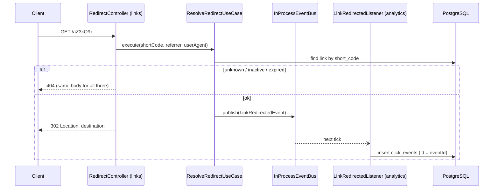
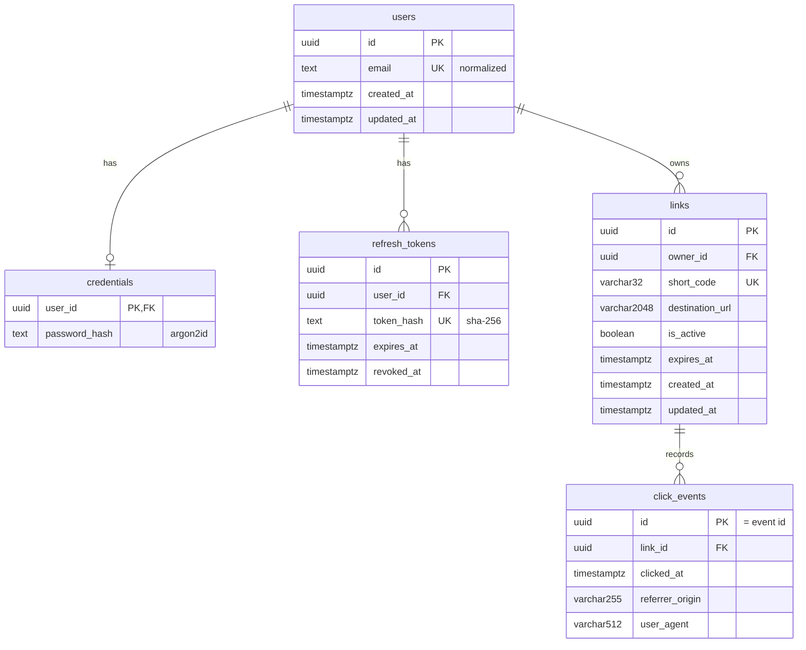

# URL Shortener System (with additional web interface)

A small, production-minded URL shortener API built as a **modular monolith**
with **Clean Architecture**. Users register, create short links (random codes
or custom aliases), manage their own links, share `/<code>` URLs that redirect
with HTTP 302, and read per-link click analytics.

The project is backend-first on purpose. It favours clear module boundaries,
explicit business rules and tests over a long feature list.

## Contents

- [Scope](#scope)
- [Technology stack](#technology-stack)
- [Architecture](#architecture)
- [Composable Enterprise: modules as PBCs](#composable-enterprise-modules-as-pbcs)
- [Database schema](#database-schema)
- [API](#api)
- [Environment variables](#environment-variables)
- [Local setup](#local-setup)
- [Deploy on Dokploy](#deploy-on-dokploy)
- [Migrations and seed data](#migrations-and-seed-data)
- [Tests](#tests)
- [Design decisions and trade-offs](#design-decisions-and-trade-offs)
- [Known limitations](#known-limitations)
- [AI-assisted development log](#ai-assisted-development-log)

## Scope

In scope:

- Registration, login, JWT access tokens, refresh-token rotation and logout
- Create, list (paginated), read, update and delete your own short links
- Random 7-character codes (Nano ID) or custom aliases
- Activation/deactivation and expiry of links
- Public `GET /:shortCode` redirect (302)
- Click recording through an in-process event and per-link analytics

Not in scope: frontend, Redis, message brokers, microservices, QR codes,
custom domains, teams, geographic analytics.

## Technology stack

| Area               | Choice                                                                   |
| ------------------ | ------------------------------------------------------------------------ |
| Language / runtime | TypeScript (strict), Node.js 22+ (developed on 24)                       |
| Framework          | NestJS 11                                                                |
| Database / ORM     | PostgreSQL 17, Prisma 7 (`@prisma/adapter-pg`)                           |
| Validation         | class-validator, class-transformer                                       |
| Auth               | `@nestjs/jwt` + own guard; Argon2id password hashing                     |
| Short codes        | `nanoid` v3 (CommonJS-compatible)                                        |
| Rate limiting      | `@nestjs/throttler`                                                      |
| Events             | In-process event bus (`shared/events`)                                   |
| Tests              | Jest + Supertest                                                         |
| API docs           | Swagger / OpenAPI (`@nestjs/swagger`)                                    |
| Containers         | Multi-stage `Dockerfile` (non-root), Docker Compose (`app` + `postgres`) |

## Architecture

### Modules


| Module      | Owns                                                           | Public API to other modules                           |
| ----------- | -------------------------------------------------------------- | ----------------------------------------------------- |
| `users`     | `users` table, email normalization                             | `UsersApi` (`create`, `findByEmail`)                  |
| `auth`      | `credentials`, `refresh_tokens`; register/login/refresh/logout | `JwtAuthGuard`, `@CurrentUser()`, `TOKEN_VERIFIER`    |
| `links`     | `links` table, short codes, redirect                           | `LinksApi` (`assertOwnership`), `LinkRedirectedEvent` |
| `analytics` | `click_events` table                                           | —                                                     |

Dependency rules:

- A module never imports another module's repository or reads its tables.
  It uses the other module's exported public API, or subscribes to its events.
- No cycles: `analytics → links → auth → users`.
- `shared/` holds technical concerns only (database, events, HTTP helpers,
  config, error mapping). It contains no business rules.

### Layers inside a module

```text
interfaces/      HTTP controllers, request/response DTOs, event listeners
application/     use cases, ports (contracts), application models
domain/          entities, value objects, domain errors, repository contracts
infrastructure/  Prisma repositories, Argon2/JWT/Nano ID adapters
```

`interfaces → application → domain` and `infrastructure → domain`
contracts. The domain doesn't import NestJS, Prisma or HTTP. Use cases are
plain classes wired with `useFactory` in each `*.module.ts`. Business errors
extend `ApplicationError` with a `kind`. The global `AllExceptionsFilter` is
the only place that maps a kind to an HTTP status, and every error returns
`{ statusCode, error, message }`.

### Redirect and click flow



## Composable Enterprise: modules as PBCs

In a Composable Enterprise, the system is built from **Packaged Business
Capabilities (PBCs)**. A PBC is a self-contained business capability that
owns its data and logic and is reached only through a published contract
(an API or an event), so it can be recombined or replaced without changing
the others.

Here each module is one PBC inside a single deployable app:

| PBC         | Owns (data + rules)                        | Contract it offers                | Contract it consumes              |
| ----------- | ------------------------------------------ | --------------------------------- | --------------------------------- |
| `users`     | `users` table, email rules                 | `UsersApi`                        | —                                 |
| `auth`      | `credentials`, `refresh_tokens`, JWT       | `JwtAuthGuard`, `@CurrentUser()`  | `UsersApi`                        |
| `links`     | `links` table, short codes, redirect rules | `LinksApi`, `LinkRedirectedEvent` | auth guard                        |
| `analytics` | `click_events` table                       | —                                 | `LinksApi`, `LinkRedirectedEvent` |

What makes them composable:

- **Contracts, not internals.** Contracts live in `application/contracts`
  and are bound to DI tokens (`USERS_API`, `LINKS_API`). They use plain
  TypeScript types, never Prisma models or HTTP DTOs.
- **Events for side effects.** `links` publishes `LinkRedirectedEvent` and
  doesn't know who listens. Analytics could be removed, or a second
  subscriber added, with no change to `links`.
- **Replaceable transport.** Events go through the `EventPublisher` /
  `EventSubscriber` ports. Swapping the in-process bus for an outbox +
  broker is an infrastructure change only.
- **Replaceable storage.** Each PBC defines its repository interface in
  `domain/repositories`. Prisma/PostgreSQL is one implementation in
  `infrastructure/persistence`.

How a PBC could be extracted later, e.g. analytics as its own service:
point an `EventSubscriber` at a broker instead of the in-process bus, and
replace the `LINKS_API` binding with an HTTP client that implements the
same `LinksApi` interface. The use cases don't change.

What this MVP does not do: PBCs share one process and one database (each
with its own tables), and events are in-memory. That keeps it simple; the
contracts are where the seams are.

## Database schema



- Every foreign key is `ON DELETE CASCADE`.
- Indexes: `links(short_code)` unique, `links(owner_id, created_at)`,
  `click_events(link_id, clicked_at)`, `refresh_tokens(token_hash)` unique,
  `refresh_tokens(user_id)`.
- Uniqueness of email, short codes and refresh tokens is enforced by the
  database. The application never relies on check-then-insert.

## API

Swagger UI: **http://localhost:3000/api/docs** (when the app is running).

| Method | Path                                     | Auth   | Purpose                                                          |
| ------ | ---------------------------------------- | ------ | ---------------------------------------------------------------- |
| POST   | `/api/v1/auth/register`                  | —      | Register (201)                                                   |
| POST   | `/api/v1/auth/login`                     | —      | Access + refresh token                                           |
| POST   | `/api/v1/auth/refresh`                   | —      | Rotate refresh token, new pair                                   |
| POST   | `/api/v1/auth/logout`                    | —      | Revoke a refresh token (204)                                     |
| POST   | `/api/v1/links`                          | Bearer | Create link (random code or `alias`)                             |
| GET    | `/api/v1/links?page&limit`               | Bearer | List own links, newest first                                     |
| GET    | `/api/v1/links/:id`                      | Bearer | Get own link                                                     |
| PATCH  | `/api/v1/links/:id`                      | Bearer | Update `destinationUrl`, `isActive`, `expiresAt` (`null` clears) |
| DELETE | `/api/v1/links/:id`                      | Bearer | Delete own link (204)                                            |
| GET    | `/api/v1/links/:id/analytics?page&limit` | Bearer | Click summary + paginated clicks                                 |
| GET    | `/:shortCode`                            | —      | 302 redirect                                                     |

Status code conventions:

| Status | When                                                                                         |
| ------ | -------------------------------------------------------------------------------------------- |
| 400    | Invalid input, including unknown fields and `null` where it has no meaning                   |
| 401    | Missing or invalid token; bad credentials (one message for unknown email and wrong password) |
| 404    | Unknown link, or another user's link (never 403); unknown, inactive or expired short code    |
| 409    | Email taken; alias taken                                                                     |
| 429    | Rate limit exceeded: auth routes 5/min, link creation 30/min, everything else 100/min per IP |

Pagination: `page` 1–10000 (default 1), `limit` 1–100 (default 20).

## Environment variables

Copy `.env.example` to `.env`. The app validates these at startup and refuses
to boot if one is invalid.

| Variable                                                                | Required     | Default                                                  | Purpose                                             |
| ----------------------------------------------------------------------- | ------------ | -------------------------------------------------------- | --------------------------------------------------- |
| `PORT`                                                                  | no           | `3000`                                                   | HTTP port                                           |
| `DATABASE_URL`                                                          | yes          | —                                                        | PostgreSQL connection string                        |
| `JWT_SECRET`                                                            | yes          | —                                                        | HMAC secret, at least 32 characters                 |
| `JWT_EXPIRES_IN`                                                        | no           | `15m`                                                    | Access-token lifetime (`<n>ms\|s\|m\|h\|d`)         |
| `JWT_ISSUER`                                                            | yes          | —                                                        | `iss` claim, verified                               |
| `JWT_AUDIENCE`                                                          | yes          | —                                                        | `aud` claim, verified                               |
| `REFRESH_TOKEN_TTL_DAYS`                                                | no           | `7`                                                      | Refresh-token lifetime                              |
| `PUBLIC_BASE_URL`                                                       | no           | `http://localhost:3000`                                  | Base of `shortUrl` in responses                     |
| `POSTGRES_USER` / `POSTGRES_PASSWORD` / `POSTGRES_DB` / `POSTGRES_PORT` | compose only | `url_shortener` / `change-me` / `url_shortener` / `5432` | Used by `docker-compose.yml` to create the database |
| `WEB_PORT`                                                              | compose only | `8080`                                                   | Host port for the `web` service                     |

`.env` is gitignored, and `.env.example` contains placeholders only.

## Local setup

Prerequisites: Node.js 22+ and npm, Docker with Docker Compose v2.24+ (for optional `env_file` entries).

From a clean checkout:

```bash
cp .env.example .env               # then set JWT_SECRET (≥ 32 chars) and the DB password
npm ci
docker compose up -d postgres      # PostgreSQL 17 with a healthcheck and a named volume
npx prisma migrate deploy          # apply all migrations
npx prisma generate                # generate the Prisma client into src/shared/database/generated
npm run start:dev                  # API on http://localhost:3000, Swagger at /api/docs
```

Keep the DB password URL-safe (letters, digits, `-`, `_`): it is embedded
unescaped in `DATABASE_URL`, so `@ : / # %` would break the connection string.

Production-like run, with the API in a container as well — **one command**
from a fresh clone:

```bash
docker compose up --build          # postgres (healthcheck) → app: migrate deploy → node dist/main
```

With no `.env`, compose uses the placeholder values from `.env.example`, which
are fine for a local demo only. For anything else, `cp .env.example .env`,
set a real `JWT_SECRET` and a URL-safe DB password; `.env` overrides the
defaults.

- `app` waits for Postgres to report healthy. It then applies migrations
  (`prisma migrate deploy`) and starts on `http://localhost:${PORT:-3000}`.
  The `app` and `postgres` ports are bound to `127.0.0.1` only; other machines
  reach the API through `web`, whose nginx sets `X-Forwarded-For` for the
  rate limits.
- App values come from `.env.example`, overridden by `.env` when it exists.
  Compose itself sets two: `DATABASE_URL` points at the `postgres` service,
  and `PORT` is fixed at `3000` inside the container. `PORT` in `.env` only
  chooses the host port.
- The image contains no secrets. `.dockerignore` keeps `.env` out of the
  build context.
- The runtime stage has production dependencies and `dist/` only, and runs
  as the non-root `node` user.
- `web` is a separate service (`web/`, SvelteKit built as a static SPA) on
  `http://localhost:${WEB_PORT:-8080}`. Its nginx serves the SPA under
  `/app/` and proxies everything else (`/api/*`, `GET /:shortCode`) to
  `app`, so the browser talks to one origin and the API needs no CORS. The
  SPA sits under `/app` because the redirect owns the root paths. FE and API
  deploy and scale independently.

Web app in dev mode (with the API running on port 3000):

```bash
cd web && npm ci && npm run dev    # http://localhost:5173/app/, /api proxied to :3000
```

Without Docker for the API:

```bash
npm run build
npm run start:prod
```

Quick check:

```bash
curl -s -X POST localhost:3000/api/v1/auth/register \
  -H 'content-type: application/json' \
  -d '{"email":"me@example.com","password":"correct-password"}'
TOKEN=$(curl -s -X POST localhost:3000/api/v1/auth/login \
  -H 'content-type: application/json' \
  -d '{"email":"me@example.com","password":"correct-password"}' | jq -r .accessToken)
curl -s -X POST localhost:3000/api/v1/links -H "authorization: Bearer $TOKEN" \
  -H 'content-type: application/json' -d '{"destinationUrl":"https://example.com"}'
curl -i localhost:3000/<shortCode>   # 302
```

Stop everything with `docker compose down`. Add `-v` to also delete the
database volume.

## Deploy on Dokploy

Everything Dokploy-specific lives in `docker/dokploy/`. Its
`docker-compose.yml` builds the same images as the local one, but it
publishes no host ports, so Traefik is the only way in. It also mounts
`nginx-real-ip.conf` into `web`, so nginx takes the client IP from the
`X-Forwarded-For` header Traefik sets. Without that, every visitor would
share Traefik's rate limit.

1. Create a project, then add a **Compose** service of type _Docker Compose_
   that points at this repository. Set **Compose Path** to
   `./docker/dokploy/docker-compose.yml`.
2. Under **Advanced → Utilities**, turn on **Isolated Deployments**. This is
   required: nginx trusts `X-Forwarded-For` from any private address, so
   `web` must only share a network with Traefik and this stack. On the shared
   `dokploy-network`, any other app's container could call `web:8080` with a
   forged header and pick its own rate-limit key.
3. In **Environment**, set at least these three:

   ```dotenv
   POSTGRES_PASSWORD=<URL-safe random string: letters, digits, - and _>
   JWT_SECRET=<32+ random characters>
   PUBLIC_BASE_URL=https://<your-domain>
   ```

   `POSTGRES_USER`, `POSTGRES_DB`, `JWT_EXPIRES_IN`, `JWT_ISSUER`,
   `JWT_AUDIENCE` and `REFRESH_TOKEN_TTL_DAYS` are optional and fall back to
   the `.env.example` defaults. If a required variable is missing, the
   deploy fails with a message that names it.
4. In **Domains**, add `<your-domain>` with service `web`, port `8080`, path
   `/`, and HTTPS on (Let's Encrypt). Point the domain's DNS `A` record at
   the server.
5. Click **Deploy**. The `app` service applies migrations on start. The SPA is
   at `https://<your-domain>/app/` and Swagger at `/api/docs`.

Keep Traefik's `forwardedHeaders.insecure` and `trustedIPs` unset on its
entrypoints (Dokploy doesn't set them). With them unset, Traefik removes any
`X-Forwarded-For` header the client sends. If they are set, clients could
choose their own rate-limit key again. Postgres data lives in the
`postgres_data` named volume, which Dokploy's Volume Backups can back up.

To test this file locally, run it as a separate project. Requests have to
come from a container on that project's network (playing Traefik), because
no port is published:

```bash
export POSTGRES_PASSWORD=pw JWT_SECRET=0123456789abcdef0123456789abcdef \
  PUBLIC_BASE_URL=https://sho.example.test
docker compose -p dokploytest -f docker/dokploy/docker-compose.yml --env-file /dev/null up -d --build
docker run --rm --network dokploytest_default curlimages/curl:8.11.1 -s -o /dev/null \
  -w '%{http_code}\n' http://web:8080/app/      # 200
docker compose -p dokploytest -f docker/dokploy/docker-compose.yml --env-file /dev/null down -v
```

## Migrations and seed data

```bash
npx prisma migrate deploy   # apply pending migrations (what deployments use)
npx prisma migrate dev      # local only: create a migration from schema changes
npx prisma generate         # regenerate the client after any schema change
```

Migrations live in `prisma/migrations/`. `prisma db push` is not used.

There is no seed script. The API needs no reference data, so register a user
through the API instead.

## Tests

```bash
npm test             # unit tests: no database, ports mocked
npm run test:e2e     # end-to-end with Supertest against real PostgreSQL (needs .env + migrations)
npm run test:cov     # unit coverage
npm run lint         # eslint (with --fix)
npm run build        # type-check + compile
```

- `test:e2e` sets `NODE_OPTIONS=--experimental-vm-modules`. Prisma 7 loads its
  query compiler with a dynamic `import()`, which Jest allows only with that
  flag.

## AI-assisted development log

**Tools:** ChatGPT & Claude Code (CLI agent) for planning, implementation, tests and
docs. A **tech-lead** reviewer agent and a **developer** fixer agent ran the
review loop defined in `AGENTS.md`.

**Workflow per feature**

1. _Plan first:_ the agent wrote `docs/N-<module>.md`. The plan covers
   scope, schema, layout, contracts, use-case behaviour, validation,
   security checklist, tests and implementation order. It was reviewed and
   adjusted before any code was written.
2. _Implement_ layer by layer: domain → application (with unit tests) →
   infrastructure → interfaces, then e2e tests.
3. _Verify:_ run lint, build, unit and e2e tests against real PostgreSQL
   before calling anything done.
4. _Review loop:_ the tech-lead agent reviewed the diff, and the developer
   agent fixed the accepted findings. Then all checks ran again.
5. _Sync docs:_ each plan gets a status line and a "changes made during
   implementation" table.
6. _Security Audit_: after complete the whole project, make a security skill to scan all the code and a code smell that can lead to security concern, and after found some concern review by human and fix it.

**Example of prompts** : (Noted: We can prompt everything simple beacause we already have a fixed example and convention from the project skills and agant.md )

- "Plan the links module and save it in docs/."
- "Should auth and users be separate modules?" (We first kept them together.
  We split them later, once credentials and identity needed separate owners.)
- "Add full refresh-token support; add tables if needed and update the docs."
- "Is this plan event-driven? What does the event help with? Who receives it?"
- "Implement" (links, then analytics) · "Commit, then write the analytics plan."
