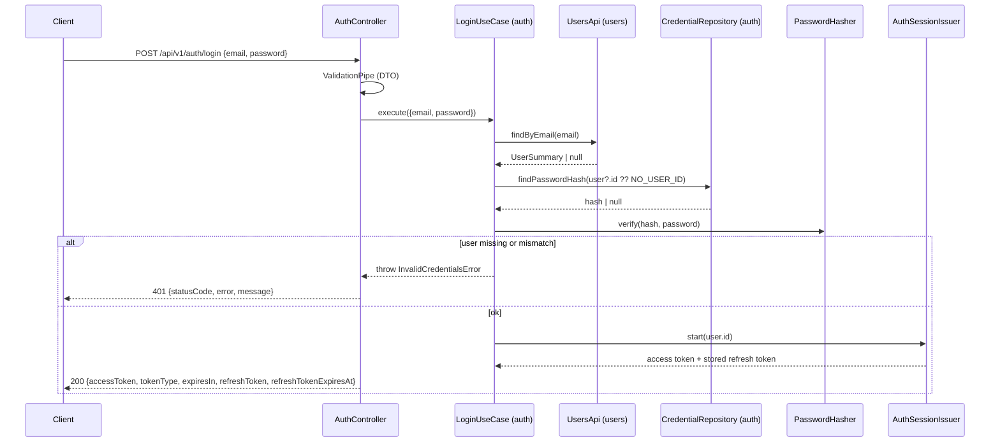

# Users & Authentication — Implementation Plan

Status: implemented. Owner modules: `users` (identity) and `auth`
(credentials, tokens, guard).

These are the first business modules. `links` and `analytics` depend on the
authentication guard that `auth` exports, so they are built first.

**Prerequisite:** [1-setup-infrastructure.md](1-setup-infrastructure.md) —
PostgreSQL, Prisma, Docker, env config, error filter, validation pipe, Swagger.

## Decisions on conflicting guidance

`AGENTS.md` takes precedence over `.agents/skills/project-conventions`:

| Topic | Conventions skill | Decision | Reason |
|-------|-------------------|----------|--------|
| JWT | Passport | **`@nestjs/jwt` + own guard** | AGENTS.md: "Self-verify with lib"; one guard doesn't need Passport's strategy layer |

Changes made during implementation:

| Plan | Built | Reason |
|------|-------|--------|
| `register.request.ts` + `login.request.ts` | one `CredentialsRequest` | Both routes take exactly email + password with the same rules |
| Use case passes `DUMMY_HASH` to `verify` | `verify(hash \| null, plain)`; the Argon2 adapter holds the dummy hash | The dummy hash is an Argon2 detail; the use case shouldn't know the hash format |
| `@CurrentUser('id')` | `@CurrentUser()` → `AuthenticatedUser { id }` | One field; a field argument adds nothing yet |
| Separate Prisma integration suite | Covered by e2e | The duplicate-email e2e test goes through the real repository and the DB unique constraint |
| `JWT_EXPIRES_IN` non-empty | Must match `^[1-9]\d*(ms\|s\|m\|h\|d)$` | A bad value would otherwise only fail at the first login; the unit is required because a bare number would be read as milliseconds |
| Refresh tokens out of scope | Added: opaque, rotated, single-use (§6) | Without them users re-log in every 15 minutes and logout can't end a session on the server |
| Token families + reuse detection | Not added: a revoked token is just rejected | Keeps the MVP small; see §6 trade-offs for what this gives up |
| `AccessTokenResponse` | `AuthSessionResponse` | Login and refresh both return the access + refresh token pair |
| One `users` module for identity and auth | Split into `users` + `auth`; `password_hash` moved to `credentials` (§3, §4) | "Who the user is" and "how they prove it" change for different reasons; `auth` owns the hash, so it never crosses a module boundary |

## 1. Scope

In scope:

- `POST /api/v1/auth/register`
- `POST /api/v1/auth/login`
- `POST /api/v1/auth/refresh` — rotate a refresh token into a new token pair
- `POST /api/v1/auth/logout` — revoke the session behind a refresh token
- JWT access token + opaque refresh token with rotation
- `JwtAuthGuard` and `@CurrentUser()` exported for `links` / `analytics`

Out of scope (known limitations): revoking access tokens before they expire
(logout ends the refresh token; the current access token lives out its
15 minutes), "log out everywhere", cleanup of expired `refresh_tokens` rows,
email verification, password reset, `/me`, roles.

## 2. New dependencies

| Package | Why |
|---------|-----|
| `@nestjs/jwt` | Sign / verify JWT |
| `argon2` | Password hashing (required). Its install script is approved in `allowScripts` so it can build where no prebuilt binary exists |

Uses the `JWT_*` and `REFRESH_TOKEN_TTL_DAYS` variables defined in
setup-infrastructure §4. Refresh tokens need no new package: `node:crypto`
provides the random bytes and SHA-256.

## 3. Persistence

```prisma
model User {                             // owned by users
  id        String   @id @default(uuid()) @db.Uuid
  email     String   @unique               // stored normalized (trim + lowercase)
  createdAt DateTime @default(now()) @map("created_at")
  updatedAt DateTime @updatedAt @map("updated_at")

  credential    Credential?
  refreshTokens RefreshToken[]

  @@map("users")
}

model Credential {                       // owned by auth
  userId       String @id @map("user_id") @db.Uuid
  passwordHash String @map("password_hash")

  user User @relation(fields: [userId], references: [id], onDelete: Cascade)

  @@map("credentials")
}

model RefreshToken {                     // owned by auth
  id        String    @id @default(uuid()) @db.Uuid
  userId    String    @map("user_id") @db.Uuid
  tokenHash String    @unique @map("token_hash")   // SHA-256; the token itself is never stored
  expiresAt DateTime  @map("expires_at")
  revokedAt DateTime? @map("revoked_at")
  createdAt DateTime  @default(now()) @map("created_at")

  user User @relation(fields: [userId], references: [id], onDelete: Cascade)

  @@index([userId])
  @@map("refresh_tokens")
}
```

- Migrations: `init_users`, `add_refresh_tokens`, then
  `move_password_hash_to_credentials`. The last one creates `credentials`,
  copies every existing `users.password_hash` into it, and only then drops
  the column, so existing users can still log in. Rollback: add
  `users.password_hash` back, copy it from `credentials`, drop `credentials`.
- Each table has one owning module, and only that module's repositories
  query it. Foreign keys across module tables (`credentials.user_id`,
  `refresh_tokens.user_id` → `users.id`) are allowed: they are referential
  integrity, not cross-module access.
- Email uniqueness is enforced by the DB constraint. There is no
  "check-then-insert" in the application — that races. Prisma error `P2002`
  is mapped to a domain error in the repository.
- `refresh_tokens.token_hash` is unique so a token is found by its hash in
  one indexed lookup. Deleting a user cascades to their credential and
  refresh tokens.
- Rows are revoked, never deleted. Expired and revoked rows accumulate; a
  periodic cleanup job is a known limitation.

## 4. Module layout

Dependency direction: `auth → users` (through `UsersApi` only) and
`auth, users → shared`. `users` knows nothing about `auth`.

### `src/modules/users/` — identity

```text
domain/
  entities/user.entity.ts             User { id, email: Email, createdAt } (no password)
  value-objects/email.vo.ts           trim + lowercase + format check
  repositories/user.repository.ts     UserRepository + USER_REPOSITORY token
  errors/
    invalid-email.error.ts            (kind: validation)
    email-already-registered.error.ts (kind: conflict)
application/
  contracts/users-api.ts              UsersApi + USERS_API token: the module's public API
  models/user-summary.ts              { id, email, createdAt } returned across the boundary
  services/users-api.service.ts       UsersApi implementation; normalizes email via Email
infrastructure/
  persistence/prisma-user.repository.ts   P2002 → EmailAlreadyRegisteredError; record → entity
users.module.ts                           exports USERS_API only
```

### `src/modules/auth/` — credentials, sessions, guard

```text
domain/
  entities/refresh-token.entity.ts    RefreshToken { id, userId, expiresAt, revokedAt }
                                      + isRevoked(), isExpired(now)
  repositories/credential.repository.ts     CredentialRepository + token
  repositories/refresh-token.repository.ts  RefreshTokenRepository + token
  errors/
    invalid-credentials.error.ts      (kind: unauthorized)
    invalid-refresh-token.error.ts    (kind: unauthorized)
application/
  contracts/password-hasher.ts        PasswordHasher { hash, verify } + token
  contracts/token-issuer.ts           TokenIssuer { issue(userId) } + token
  contracts/token-verifier.ts         TokenVerifier { verify(token) → userId | null } + token
  models/credentials.ts               { email, password } use-case input
  models/access-token.ts              { accessToken, expiresIn }
  models/auth-session.ts              AccessToken + { refreshToken, refreshTokenExpiresAt }
  services/auth-session-issuer.ts     builds the token pair: start / rotate;
                                      hashRefreshToken()
  use-cases/register-user.use-case.ts
  use-cases/login.use-case.ts
  use-cases/refresh-session.use-case.ts
  use-cases/logout.use-case.ts
infrastructure/
  persistence/prisma-credential.repository.ts
  persistence/prisma-refresh-token.repository.ts  rotate = one transaction with a
                                          conditional revoke (race guard)
  security/argon2-password-hasher.ts      argon2id, library defaults; dummy hash for null
  security/jwt-token-issuer.ts            signAsync({ sub }); options come from JwtModule
  security/jwt-token-verifier.ts          verifyAsync → sub, any failure → null
interfaces/http/
  controllers/auth.controller.ts          thin: DTO → use case → response DTO
  dto/credentials.request.ts
  dto/user.response.ts                    from UserSummary
  dto/refresh-token.request.ts            { refreshToken } for refresh + logout
  dto/auth-session.response.ts
  models/authenticated-user.ts            { id }
  models/authenticated-request.ts         express Request + user
  guards/jwt-auth.guard.ts                public API for other modules
  decorators/current-user.decorator.ts    public API for other modules
auth.module.ts                            imports UsersModule; binds tokens → implementations;
                                          JwtModule holds secret + issuer/audience/expiry;
                                          exports guard + TOKEN_VERIFIER
```

### `src/shared/database/` — cross-module transactions

```text
transaction-runner.ts            TransactionRunner { runInTransaction(work) } + token
prisma-transaction-context.ts    implements it with AsyncLocalStorage; `db` is the
                                 active transaction client, or the root client
```

Register writes to two modules' tables (`users`, `credentials`), which must
succeed or fail together. `RegisterUserUseCase` wraps both calls in
`runInTransaction`; `PrismaUserRepository` and `PrismaCredentialRepository`
read `PrismaTransactionContext.db`, so they join the transaction without either
module touching the other's tables or Prisma leaking into the use case. A nested
`runInTransaction` joins the outer one. The context is its own class, not a
getter on `PrismaService`: `PrismaClient` is a Proxy, and a getter on it sees the
bare target without the model delegates.

Contracts:

```ts
// users — public API
export interface UsersApi {
  create(email: string): Promise<UserSummary>; // throws InvalidEmailError, EmailAlreadyRegisteredError
  findByEmail(email: string): Promise<UserSummary | null>; // throws InvalidEmailError
}

// users — internal
export interface UserRepository {
  create(email: Email): Promise<User>; // throws EmailAlreadyRegisteredError
  findByEmail(email: Email): Promise<User | null>;
}

// auth
export interface CredentialRepository {
  create(userId: string, passwordHash: string): Promise<void>;
  findPasswordHash(userId: string): Promise<string | null>;
}

export interface PasswordHasher {
  hash(plain: string): Promise<string>;
  verify(hash: string | null, plain: string): Promise<boolean>; // null → full-cost check, false
}

export interface TokenIssuer {
  issue(userId: string): Promise<{ accessToken: string; expiresIn: string }>;
}

export interface TokenVerifier {
  verify(accessToken: string): Promise<string | null>; // userId, or null for any invalid token
}

export interface RefreshTokenRepository {
  create(refreshToken: NewRefreshToken): Promise<void>;
  findByTokenHash(tokenHash: string): Promise<RefreshToken | null>;
  rotate(currentId: string, next: NewRefreshToken): Promise<boolean>; // false: already revoked
  revoke(id: string): Promise<void>; // no-op if already revoked
}

// shared
export interface TransactionRunner {
  runInTransaction<T>(work: () => Promise<T>): Promise<T>;
}
```

`UsersApi` is the only way into `users`: `auth` never imports its
repository, entity or Prisma table. It returns `UserSummary`, a plain object,
so the `User` entity and `Email` value object stay inside `users`.

`AuthSessionIssuer` is a plain class, not a contract: login and refresh both
need "issue access token + build refresh token", and the only technical
dependency it adds is `node:crypto` (stdlib), so there is nothing to swap
out. Unit tests use the real issuer with a mocked repository.

Why `PasswordHasher`, `TokenIssuer` and `TokenVerifier` are abstractions: they
keep the use cases and the guard free of Argon2 and JWT, and unit tests can use
fakes (AGENTS.md §3.2, §10). Because the guard depends on `TokenVerifier`,
`AuthModule` exports that token instead of `JwtModule`, so consumers never see
that tokens are JWTs. Use cases are plain classes (no Nest decorators), wired
with `useFactory` in each module.

## 5. Request flow



## 6. Use-case behavior

### RegisterUser

1. `hasher.hash(password)`, outside the transaction: Argon2 is slow and must
   not hold a DB connection.
2. `runInTransaction`:
   1. `usersApi.create(email)`. `users` normalizes and validates the email;
      the DB unique constraint catches duplicates.
   2. `credentialRepository.create(user.id, hash)`.

If either insert fails, both roll back, so a user can never exist without a
credential (that user could never log in, and re-registering would 409).

| Case | Result |
|------|--------|
| Success | **201** `{ id, email, createdAt }` — no hash, no token |
| Email taken | `EmailAlreadyRegisteredError` → **409** |
| Invalid body | **400** |

### Login

1. `usersApi.findByEmail(email)`
2. `credentialRepository.findPasswordHash(userId)`. For an unknown email it
   looks up a nil UUID, so both paths run the same queries.
3. Always call `hasher.verify` — with `null` when there is no hash; the
   Argon2 adapter then verifies against a fixed dummy hash, so response time
   doesn't reveal whether the email is registered.
4. On success, `authSessionIssuer.start(user.id)`.

| Case | Result |
|------|--------|
| Success | **200** — see next row |
| Success (body) | `{ accessToken, tokenType, expiresIn, refreshToken, refreshTokenExpiresAt }` |
| Unknown email | **401** `"Invalid email or password"` |
| Wrong password | **401** `"Invalid email or password"` (identical) |

### RefreshSession

1. `repo.findByTokenHash(sha256(token))`; missing → `InvalidRefreshTokenError`.
2. Revoked or expired → 401.
3. `repo.rotate(id, next)` in one transaction: revoke the current row only
   if `revoked_at IS NULL`, then insert the successor. If the conditional
   update matched nothing, a concurrent request used the token first → 401.

The access token is signed **before** the refresh token is committed (in
login and refresh): a signing failure after the commit would revoke the
client's refresh token without handing back its replacement.

| Case | Result |
|------|--------|
| Success | **200** new pair (same shape as login); the sent token is revoked |
| Unknown / expired / revoked | **401** `"Invalid refresh token"` (identical) |
| Missing / empty / non-string token | **400** |

### Logout

Find by hash → `revoke(id)` → **204**. Unknown tokens also get 204, so
logout can't be used to check whether a token exists. Other logins (other
devices) are unaffected.

Accepted trade-offs:

- **No reuse detection.** A rotated token coming back is only rejected; its
  successor stays valid. If an attacker steals a refresh token and rotates it
  before the owner does, the attacker keeps the session until it expires or
  is logged out, and the owner just sees a 401. The upgrade path is token
  families: a `family_id` shared by every rotation of one login, and reuse of
  a revoked token revokes the whole family (OAuth 2.0 Security BCP, RFC 9700).
- Two concurrent refreshes of the same token (e.g. two tabs): one wins, the
  other gets 401 and the session continues on the winner's token.
- Refresh tokens go in the JSON body, not an `HttpOnly` cookie: this is an
  API with no browser frontend, so there is no cookie/CSRF setup to justify.
  A browser client would move them into a cookie.

Accepted trade-off: 409 on register reveals that an email exists. Fixing this
needs email verification, which is out of MVP scope.

## 7. Input validation

| Field | Rules |
|-------|-------|
| `email` | `IsEmail`, `MaxLength(254)` |
| `password` | `IsString`, `MinLength(8)`, `MaxLength(128)` — the cap stops very long inputs being used to make hashing expensive |
| `refreshToken` | `IsString`, `IsNotEmpty`, `MaxLength(128)` (issued tokens are 43 chars) |

Unknown fields → 400 (`forbidNonWhitelisted`). One `CredentialsRequest`
serves both routes. `IsEmail` rejects surrounding whitespace, so over HTTP
the `Email` value object's normalization only changes casing.

## 8. JwtAuthGuard (consumed by links / analytics)

- Reads `Authorization: Bearer <token>`.
- Calls `TokenVerifier.verify(token)`. `JwtTokenVerifier` uses
  `JwtService.verifyAsync`; secret, issuer and audience come from
  `JwtModule`'s `verifyOptions`, and expiry is checked by default.
- Success: sets `request.user = { id: userId }`.
- Any failure (missing, malformed, bad signature, expired, wrong iss/aud):
  **401** with a generic message.
- `@CurrentUser()` gives controllers the `AuthenticatedUser` (`{ id }`).
  Consumers import `AuthModule` and use `@UseGuards(JwtAuthGuard)`. **Ownership checks live in
  the links use cases**, not in the guard.
- Stateless (no DB lookup). Limitation: a deleted user's token stays valid
  until it expires; the 15-minute TTL limits this.

## 9. Security checklist

- [x] Argon2id hashing; plaintext never stored
- [x] `passwordHash` never in a response DTO or a log
- [x] Generic credential error + matched timing on login
- [x] `@Throttle({ default: { limit: 5, ttl: 60_000 } })` on register and login
- [x] Never log passwords, tokens, or the `Authorization` header
- [x] JWT issuer, audience and expiry are all verified
- [x] Refresh tokens: 256 random bits, stored only as SHA-256, single-use
- [x] Rotation is race-safe (conditional update in a transaction)
- [x] Refresh/logout share the auth throttle (5/min per route)
- [x] Refresh tokens never logged

## 10. Tests

**Unit** (no DB; fake repositories / `UsersApi` / hasher / issuer / transaction runner):

- `Email` — normalization, invalid formats
- `UsersApiService` — create stores the normalized email and returns a
  summary; malformed email rejected before storing; findByEmail normalizes
- `RegisterUserUseCase` — hashes the password, creates user + credential in
  one `runInTransaction`; a duplicate email propagates and no credential is
  created
- `LoginUseCase` — unknown email and wrong password give the same error;
  the credential lookup and verify still run for an unknown email; on success
  the access token is returned and a refresh token is stored as its hash
- `RefreshSessionUseCase` — rotation stores the new hash; unknown, expired
  and revoked tokens rejected without rotating; losing the rotation race is
  rejected
- `LogoutUseCase` — known token is revoked; unknown token is a no-op
- `JwtAuthGuard` (fake verifier) — missing header, non-bearer scheme, empty
  token, rejected token; valid token sets `request.user`
- `JwtTokenVerifier` — valid token returns `sub`; malformed, expired,
  wrong-audience, wrong-issuer and wrong-secret tokens return `null`
- `Argon2PasswordHasher` — argon2id round trip, wrong password, `null` hash
- `validateEnvironment` — invalid `JWT_EXPIRES_IN`

**E2E** (Supertest, `test/auth.e2e-spec.ts`, real Postgres). This also stands
in for a repository integration suite:

- register 201 with lowercased email and exactly `{ id, email, createdAt }`
- duplicate (different casing) 409 · malformed email / short password /
  unknown field 400
- login 200 with token · bad password and unknown email give the identical 401
- 429 after 5 logins in a minute
- refresh 200 with a new pair · reusing a rotated token 401 and its
  successor keeps working · two concurrent refreshes of the same token
  give exactly one 200 and one 401, and the winner's token keeps working
  · logout 204 then refresh 401 · unknown token:
  refresh 401, logout 204 · missing / empty / non-string token 400

**Transaction context** (`test/transaction-context.e2e-spec.ts`, real Postgres):

- a write followed by a failure inside `runInTransaction` is rolled back
- a nested `runInTransaction` joins the outer one: both levels roll back

Each test uses a random email, so the suite runs against the dev database
without truncating tables. A separate test database (setup §7) is not set up yet.

## 11. Implementation order

1. ~~Complete [1-setup-infrastructure.md](1-setup-infrastructure.md) steps 1–5.~~
2. ~~Add `User` model + `init_users` migration.~~
3. ~~Domain → application (+ unit tests) → infrastructure → interfaces.~~
4. ~~E2E tests; Swagger decorators.~~ README auth section: pending the
   README rewrite (it is still the Nest starter).
5. ~~Review loop: tech-lead agent review → developer agent fixes.~~
6. ~~Refresh tokens: `add_refresh_tokens` migration, refresh/logout use
   cases, e2e.~~
7. ~~Split `auth` out of `users`: `move_password_hash_to_credentials`
   migration, `UsersApi`, `TransactionRunner`.~~

## 12. Verification

```bash
npx prisma migrate dev             # Prisma 7 no longer generates here:
npx prisma generate                # regenerate the client after schema changes
npm run lint && npm run build
npm test
npm run test:e2e
```

Manual check: open `/api/docs`, register, log in, then call a guarded route
with and without the token. Refresh with the returned `refreshToken`, send
the old one again (401), then confirm the new one still works.
