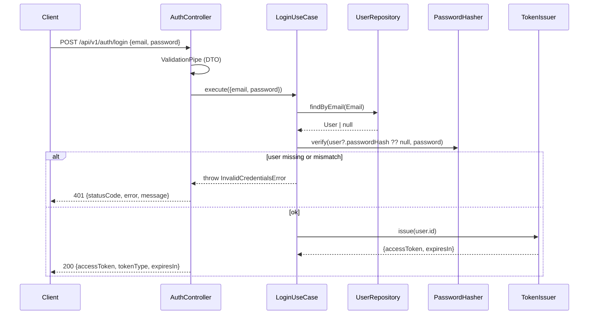

# Users & Authentication — Implementation Plan

Status: implemented. Owner module: `users`.

The `users` module is the first business module. `links` and `analytics`
depend on the authentication guard it exports, so it is built first.

**Prerequisite:** [1-setup-infrastructure.md](1-setup-infrastructure.md) —
PostgreSQL, Prisma, Docker, env config, error filter, validation pipe, Swagger.

## Decisions on conflicting guidance

`AGENTS.md` takes precedence over `.agents/skills/project-conventions`:

| Topic | Conventions skill | Decision | Reason |
|-------|-------------------|----------|--------|
| JWT | Passport | **`@nestjs/jwt` + own guard** | AGENTS.md: "Self-verify with lib"; one guard doesn't need Passport's strategy layer |

Changes made during implementation:

| Plan | Built | Reason |
|------|-------|--------|
| `register.request.ts` + `login.request.ts` | one `CredentialsRequest` | Both routes take exactly email + password with the same rules |
| Use case passes `DUMMY_HASH` to `verify` | `verify(hash \| null, plain)`; the Argon2 adapter holds the dummy hash | The dummy hash is an Argon2 detail; the use case shouldn't know the hash format |
| `@CurrentUser('id')` | `@CurrentUser()` → `AuthenticatedUser { id }` | One field; a field argument adds nothing yet |
| Separate Prisma integration suite | Covered by e2e | The duplicate-email e2e test goes through the real repository and the DB unique constraint |
| `JWT_EXPIRES_IN` non-empty | Must match `^[1-9]\d*(ms\|s\|m\|h\|d)$` | A bad value would otherwise only fail at the first login; the unit is required because a bare number would be read as milliseconds |

## 1. Scope

In scope:

- `POST /api/v1/auth/register`
- `POST /api/v1/auth/login`
- JWT access token
- `JwtAuthGuard` and `@CurrentUser()` exported for `links` / `analytics`

Out of scope (known limitations): refresh tokens, logout/revocation, email
verification, password reset, `/me`, roles.

## 2. New dependencies

| Package | Why |
|---------|-----|
| `@nestjs/jwt` | Sign / verify JWT |
| `argon2` | Password hashing (required). Its install script is approved in `allowScripts` so it can build where no prebuilt binary exists |

Uses `JWT_*` variables defined in setup-infrastructure §4.

## 3. Persistence

```prisma
model User {
  id           String   @id @default(uuid()) @db.Uuid
  email        String   @unique            // stored normalized (trim + lowercase)
  passwordHash String   @map("password_hash")
  createdAt    DateTime @default(now()) @map("created_at")
  updatedAt    DateTime @updatedAt @map("updated_at")

  @@map("users")
}
```

- Migration: `npx prisma migrate dev --name init_users`.
- Email uniqueness is enforced by the DB constraint. There is no
  "check-then-insert" in the application — that races. Prisma error `P2002`
  is mapped to a domain error in the repository.

## 4. Module layout (`src/modules/users/`)

```text
domain/
  entities/user.entity.ts             User { id, email: Email, passwordHash, createdAt }
  value-objects/email.vo.ts           trim + lowercase + format check
  repositories/user.repository.ts     UserRepository + USER_REPOSITORY token
  errors/
    invalid-email.error.ts            (kind: validation)
    email-already-registered.error.ts (kind: conflict)
    invalid-credentials.error.ts      (kind: unauthorized)
application/
  contracts/password-hasher.ts        PasswordHasher { hash, verify } + token
  contracts/token-issuer.ts           TokenIssuer { issue(userId) } + token
  contracts/token-verifier.ts         TokenVerifier { verify(token) → userId | null } + token
  models/credentials.ts               { email, password } use-case input
  models/access-token.ts              { accessToken, expiresIn }
  use-cases/register-user.use-case.ts
  use-cases/login.use-case.ts
infrastructure/
  persistence/prisma-user.repository.ts   P2002 → EmailAlreadyRegisteredError; record → entity
  security/argon2-password-hasher.ts      argon2id, library defaults; dummy hash for null
  security/jwt-token-issuer.ts            signAsync({ sub }); options come from JwtModule
  security/jwt-token-verifier.ts          verifyAsync → sub, any failure → null
interfaces/http/
  controllers/auth.controller.ts          thin: DTO → use case → response DTO
  dto/credentials.request.ts
  dto/user.response.ts
  dto/access-token.response.ts
  models/authenticated-user.ts            { id }
  models/authenticated-request.ts         express Request + user
  guards/jwt-auth.guard.ts                public API for other modules
  decorators/current-user.decorator.ts    public API for other modules
users.module.ts                           binds tokens → implementations; JwtModule holds
                                          secret + issuer/audience/expiry; exports guard + TOKEN_VERIFIER
```

Contracts:

```ts
export interface UserRepository {
  create(email: Email, passwordHash: string): Promise<User>; // throws EmailAlreadyRegisteredError
  findByEmail(email: Email): Promise<User | null>;
}

export interface PasswordHasher {
  hash(plain: string): Promise<string>;
  verify(hash: string | null, plain: string): Promise<boolean>; // null → full-cost check, false
}

export interface TokenIssuer {
  issue(userId: string): Promise<{ accessToken: string; expiresIn: string }>;
}

export interface TokenVerifier {
  verify(accessToken: string): Promise<string | null>; // userId, or null for any invalid token
}
```

Why `PasswordHasher`, `TokenIssuer` and `TokenVerifier` are abstractions: they keep the use
cases and the guard free of Argon2 and JWT, and unit tests can use fakes (AGENTS.md §3.2,
§10). Because the guard depends on `TokenVerifier`, `UsersModule` exports that
token instead of `JwtModule`, so consumers never see that tokens are JWTs. Use cases are plain classes (no Nest decorators), wired with
`useFactory` in `users.module.ts`.

## 5. Request flow



## 6. Use-case behavior

### RegisterUser

1. `Email.create(input.email)` (normalize + validate)
2. `hasher.hash(password)`
3. `repo.create(email, hash)`

| Case | Result |
|------|--------|
| Success | **201** `{ id, email, createdAt }` — no hash, no token |
| Email taken | `EmailAlreadyRegisteredError` → **409** |
| Invalid body | **400** |

### Login

1. `repo.findByEmail(email)`
2. Always call `hasher.verify` — with `null` when the user doesn't exist;
   the Argon2 adapter then verifies against a fixed dummy hash, so response
   time doesn't reveal whether the email is registered.
3. On success, `tokenIssuer.issue(user.id)`.

| Case | Result |
|------|--------|
| Success | **200** `{ accessToken, tokenType: 'Bearer', expiresIn }` |
| Unknown email | **401** `"Invalid email or password"` |
| Wrong password | **401** `"Invalid email or password"` (identical) |

Accepted trade-off: 409 on register reveals that an email exists. Fixing this
needs email verification, which is out of MVP scope.

## 7. Input validation

| Field | Rules |
|-------|-------|
| `email` | `IsEmail`, `MaxLength(254)` |
| `password` | `IsString`, `MinLength(8)`, `MaxLength(128)` — the cap stops very long inputs being used to make hashing expensive |

Unknown fields → 400 (`forbidNonWhitelisted`). One `CredentialsRequest`
serves both routes. `IsEmail` rejects surrounding whitespace, so over HTTP
the `Email` value object's normalization only changes casing.

## 8. JwtAuthGuard (consumed by links / analytics)

- Reads `Authorization: Bearer <token>`.
- Calls `TokenVerifier.verify(token)`. `JwtTokenVerifier` uses
  `JwtService.verifyAsync`; secret, issuer and audience come from
  `JwtModule`'s `verifyOptions`, and expiry is checked by default.
- Success: sets `request.user = { id: userId }`.
- Any failure (missing, malformed, bad signature, expired, wrong iss/aud):
  **401** with a generic message.
- `@CurrentUser()` gives controllers the `AuthenticatedUser` (`{ id }`).
  Consumers import `UsersModule` and use `@UseGuards(JwtAuthGuard)`. **Ownership checks live in
  the links use cases**, not in the guard.
- Stateless (no DB lookup). Limitation: a deleted user's token stays valid
  until it expires; the 15-minute TTL limits this.

## 9. Security checklist

- [x] Argon2id hashing; plaintext never stored
- [x] `passwordHash` never in a response DTO or a log
- [x] Generic credential error + matched timing on login
- [x] `@Throttle({ default: { limit: 5, ttl: 60_000 } })` on register and login
- [x] Never log passwords, tokens, or the `Authorization` header
- [x] JWT issuer, audience and expiry are all verified

## 10. Tests

**Unit** (no DB; fake repository / hasher / issuer):

- `Email` — normalization, invalid formats
- `RegisterUserUseCase` — hashes the password, maps duplicates to conflict,
  output has no hash
- `LoginUseCase` — unknown email and wrong password give the same error;
  verify still runs for an unknown email; token issued on success
- `JwtAuthGuard` (fake verifier) — missing header, non-bearer scheme, empty
  token, rejected token; valid token sets `request.user`
- `JwtTokenVerifier` — valid token returns `sub`; malformed, expired,
  wrong-audience, wrong-issuer and wrong-secret tokens return `null`
- `Argon2PasswordHasher` — argon2id round trip, wrong password, `null` hash
- `validateEnvironment` — invalid `JWT_EXPIRES_IN`

**E2E** (Supertest, `test/auth.e2e-spec.ts`, real Postgres). This also stands
in for a repository integration suite:

- register 201 with lowercased email and exactly `{ id, email, createdAt }`
- duplicate (different casing) 409 · malformed email / short password /
  unknown field 400
- login 200 with token · bad password and unknown email give the identical 401
- 429 after 5 logins in a minute

Each test uses a random email, so the suite runs against the dev database
without truncating tables. A separate test database (setup §7) is not set up yet.

## 11. Implementation order

1. ~~Complete [1-setup-infrastructure.md](1-setup-infrastructure.md) steps 1–5.~~
2. ~~Add `User` model + `init_users` migration.~~
3. ~~Domain → application (+ unit tests) → infrastructure → interfaces.~~
4. ~~E2E tests; Swagger decorators.~~ README auth section: pending the
   README rewrite (it is still the Nest starter).
5. ~~Review loop: tech-lead agent review → developer agent fixes.~~

## 12. Verification

```bash
npx prisma migrate dev             # Prisma 7 no longer generates here:
npx prisma generate                # regenerate the client after schema changes
npm run lint && npm run build
npm test
npm run test:e2e
```

Manual check: open `/api/docs`, register, log in, then call a guarded route
with and without the token.
