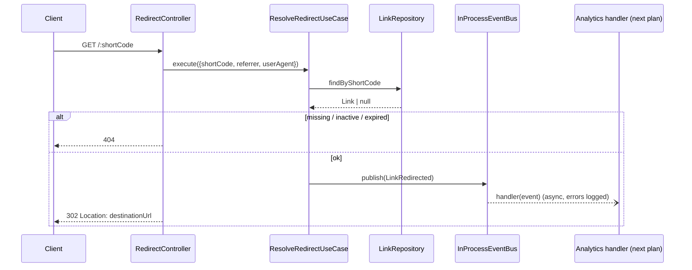

# Links — Implementation Plan

Status: implemented. Owner module: `links`.

## Changes made during implementation

| Plan | Built | Reason |
|------|-------|--------|
| `setGlobalPrefix` with `exclude: [':shortCode']` | No global prefix; API controllers use `` `${API_PREFIX}/...` `` | Nest matches `exclude` as a path pattern against every route, so `:shortCode` also excluded `GET /links` (caught by e2e: 404) |
| `repo.update(link: Link)` | `repo.update(id, changes: LinkChanges)` | Writes only the provided fields; no need to rebuild the whole entity |
| Alias regex in the DTO and the value object | DTO checks `IsString` + `MaxLength(32)`; the rule lives only in `ShortCode` | One source of truth; the domain error already gives a 400 |
| `IsISO8601` for `expiresAt` | `@Type(() => Date)` + `IsDate` | The use case gets a real `Date`; invalid dates are still a 400 |
| `DestinationUrl` checks protocol + length | Also rejects embedded credentials (`https://bank.com@evil.com`) | Classic phishing disguise for a shortener |
| `static eventName` | `static EVENT_NAME` + instance `eventName` | Subscribers name the event by class (`subscribe(LinkRedirectedEvent, …)`); the bus routes instances by `eventName` |
| `migrate dev --name add_links` | Migration generated with `migrate diff`, applied with `migrate deploy` | `migrate dev` wants a reset because `init_users` was edited after it was applied (pre-existing) |

The `links` module owns the short-link lifecycle (create, list, read, update,
delete), short-code generation and the public redirect. It publishes a
`LinkRedirected` event for each successful redirect; the `analytics` module
(next plan) subscribes to that event and records clicks.

**Prerequisites:**
[1-setup-infrastructure.md](1-setup-infrastructure.md) and
[2-users-auth.md](2-users-auth.md) — `JwtAuthGuard`, `@CurrentUser()`,
`ApplicationError` + global filter, `ValidationPipe`, throttler.

## 1. Scope

In scope:

- `POST   /api/v1/links` — create (random code or custom alias)
- `GET    /api/v1/links` — list the current user's links (paginated)
- `GET    /api/v1/links/:id` — get one owned link
- `PATCH  /api/v1/links/:id` — update destination, active flag, expiry
- `DELETE /api/v1/links/:id` — delete
- `GET    /:shortCode` — public **302** redirect (at the root, no `/api/v1`)
- `LinkRedirected` event + a minimal in-process event bus in `shared/events`
- A public module API for `analytics` to check link ownership

Out of scope (known limitations): changing a link's short code after
creation, bulk operations, link search/filtering, soft delete, QR codes,
custom domains, click recording itself (analytics plan).

## 2. New dependencies

| Package | Why |
|---------|-----|
| `nanoid@^3` | Random short codes (AGENTS.md §5). v3 because v4+ is ESM-only and this project compiles to CommonJS and runs Jest without ESM support |

New environment variable (added to `EnvironmentVariables`, `.env.example`,
README):

| Variable | Rule | Purpose |
|----------|------|---------|
| `PUBLIC_BASE_URL` | `IsUrl({ require_tld: false })`, default `http://localhost:3000` | Builds `shortUrl` in responses. Not derived from the request `Host` header, which the client controls |

## 3. Persistence

```prisma
model Link {
  id             String    @id @default(uuid()) @db.Uuid
  ownerId        String    @map("owner_id") @db.Uuid
  // Random code or custom alias; one namespace, case-sensitive.
  shortCode      String    @unique @map("short_code") @db.VarChar(32)
  destinationUrl String    @map("destination_url") @db.VarChar(2048)
  isActive       Boolean   @default(true) @map("is_active")
  expiresAt      DateTime? @map("expires_at") @db.Timestamptz(3)
  createdAt      DateTime  @default(now()) @map("created_at") @db.Timestamptz(3)
  updatedAt      DateTime  @updatedAt @map("updated_at") @db.Timestamptz(3)

  owner User @relation(fields: [ownerId], references: [id], onDelete: Cascade)

  @@index([ownerId, createdAt])
  @@map("links")
}
```

`User` gets the back-relation field `links Link[]`. This is a schema-level
foreign key only; the users module never reads links.

- Migration: `20261111140000_add_links`.
- `short_code` uniqueness is enforced by the DB unique index (which also
  serves redirect lookups). There is no check-then-insert: Prisma `P2002` on
  `short_code` is mapped to `ShortCodeTakenError` in the repository.
- `(owner_id, created_at)` serves the paginated list query.
- `onDelete: Cascade` from users: deleting a user removes their links. There
  is no user-deletion endpoint yet; this just keeps referential integrity.
- Update/delete of a missing row (Prisma `P2025`) maps to `LinkNotFoundError`.

## 4. Module layout (`src/modules/links/`)

```text
domain/
  entities/link.entity.ts              Link { id, ownerId, shortCode, destinationUrl,
                                       isActive, expiresAt, createdAt, updatedAt }
                                       + isOwnedBy(userId), canRedirect(now)
  value-objects/destination-url.vo.ts  WHATWG URL parse, http/https only, ≤ 2048, normalized href
  value-objects/short-code.vo.ts       alias format + reserved words
  repositories/link.repository.ts      LinkRepository + LINK_REPOSITORY token
  errors/
    link-not-found.error.ts            (kind: not_found)
    short-code-taken.error.ts          (kind: conflict)
    invalid-destination-url.error.ts   (kind: validation)
    invalid-short-code.error.ts        (kind: validation)
    expiration-in-past.error.ts        (kind: validation)
application/
  contracts/short-code-generator.ts    ShortCodeGenerator { generate() } + token
  events/link-redirected.event.ts      public event contract (analytics imports it)
  models/link-inputs.ts                use-case inputs
  models/link-page.ts                  { items, page, limit, total }
  use-cases/create-link.use-case.ts
  use-cases/list-links.use-case.ts
  use-cases/get-link.use-case.ts       also the public API for analytics
  use-cases/update-link.use-case.ts
  use-cases/delete-link.use-case.ts
  use-cases/resolve-redirect.use-case.ts
infrastructure/
  persistence/prisma-link.repository.ts    P2002 → ShortCodeTakenError, P2025 → LinkNotFoundError
  generators/nanoid-short-code-generator.ts customAlphabet(0-9A-Za-z, 7)
interfaces/http/
  controllers/links.controller.ts      /api/v1/links, @UseGuards(JwtAuthGuard)
  controllers/redirect.controller.ts   GET /:shortCode, public
  dto/create-link.request.ts
  dto/update-link.request.ts
  dto/link.response.ts                 includes shortUrl
  dto/link-page.response.ts
links.module.ts                        imports AuthModule; exports GetLinkUseCase

shared/events/
  domain-event.ts                      DomainEvent, DomainEventType, DomainEventHandler
  event-publisher.ts                   EventPublisher { publish(event) } + EVENT_PUBLISHER token
  in-process-event-bus.ts              publish + subscribe(EventClass, handler); setImmediate;
                                       handler errors logged, not rethrown
  events.module.ts                     @Global, binds EVENT_PUBLISHER → InProcessEventBus
shared/http/
  api-prefix.ts                        API_PREFIX = 'api/v1', used by each API controller
  pagination.query.ts                  page ≥ 1, limit 1–100 (default 20); reused by analytics
```

Contracts:

```ts
export interface LinkRepository {
  create(link: NewLink): Promise<Link>;          // throws ShortCodeTakenError
  findById(id: string): Promise<Link | null>;
  findByShortCode(shortCode: string): Promise<Link | null>;
  listByOwner(ownerId: string, page: PageRequest): Promise<{ items: Link[]; total: number }>;
  update(id: string, changes: LinkChanges): Promise<Link>; // only given fields; throws LinkNotFoundError
  delete(id: string): Promise<void>;             // throws LinkNotFoundError
}

export interface ShortCodeGenerator {
  generate(): string;
}

export interface EventPublisher {
  publish(event: DomainEvent): void;             // fire-and-forget; never throws
}

export class LinkRedirectedEvent implements DomainEvent {
  static readonly EVENT_NAME = 'links.link-redirected';
  readonly eventName = LinkRedirectedEvent.EVENT_NAME;
  readonly eventId = randomUUID();                // idempotency key for consumers
  constructor(
    readonly linkId: string,
    readonly occurredAt: Date,
    readonly referrer: string | null,
    readonly userAgent: string | null,
  ) {}
}
```

Why `ShortCodeGenerator` is an abstraction: the collision-retry rule can only
be tested deterministically with a fake generator that returns the same code
twice. Why `EventPublisher`: AGENTS.md §3.4 / §7 require the transport to be
replaceable by a broker later; the links module never learns who listens.

Ownership lives in the use cases (`link.isOwnedBy(userId)`), not in the
repository query or the controller (AGENTS.md §9).

Use cases are plain classes wired with `useFactory`, same as users.

## 5. Use-case behavior

### CreateLink

Input: `{ ownerId, destinationUrl, alias?, expiresAt? }`

1. `DestinationUrl.create(destinationUrl)`.
2. `expiresAt`, if given, must be in the future → else `ExpirationInPastError`.
3. **Alias given:** `ShortCode.fromAlias(alias)` → `repo.create`. A taken alias
   is `ShortCodeTakenError` → **409**, no retry.
4. **No alias:** up to **3 attempts**: `generator.generate()` → `repo.create`;
   on `ShortCodeTakenError`, try again. After 3 collisions, throw a plain
   `Error` → **500**. With 62⁷ ≈ 3.5 × 10¹² codes, three collisions in a row
   means something is broken, not unlucky.

| Case | Result |
|------|--------|
| Success | **201** `LinkResponse` |
| Alias taken | **409** |
| Bad URL / protocol / alias / past expiry | **400** |
| No token | **401** |

### ListLinks

`repo.listByOwner(userId, { page, limit })`, newest first →
**200** `{ items, page, limit, total }`.

### GetLink / UpdateLink / DeleteLink

1. `repo.findById(id)`.
2. Missing **or owned by someone else** → `LinkNotFoundError` → **404**.
   Same response in both cases, so link IDs of other users aren't revealed
   (no 403).
3. Update: apply only provided fields — `destinationUrl` (re-validated),
   `isActive`, `expiresAt` (`null` clears it; a date must be in the future)
   → `repo.update(link)` → **200**.
4. Delete: `repo.delete(id)` → **204**.

`shortCode` is not updatable: once shared, changing it would break existing
links.

### ResolveRedirect

Input: `{ shortCode, referrer, userAgent }`

1. Reject codes that can't exist (bad format/length) as not found, without a
   DB query.
2. `repo.findByShortCode(code)`.
3. Missing, `!isActive`, or `expiresAt <= now` → `LinkNotFoundError` →
   **404** with the same body for all three (AGENTS.md §5).
4. `eventPublisher.publish(new LinkRedirectedEvent(...))`.
5. Return `destinationUrl` → controller answers **302** via Nest's
   `@Redirect()` (no raw `Response` object in the controller).

`Link.canRedirect(now)` holds the active/expiry rule; `now` is a parameter so
the entity is tested with plain dates — no clock abstraction.

## 6. Redirect routing

There is no global prefix. API controllers declare it themselves —
`@Controller(\`${API_PREFIX}/links\`)` — and `RedirectController` uses
`@Controller()`, so it serves `GET /:shortCode` at the root.

- The route is one path segment, so it can't shadow `/api/v1/...` or
  `/api/docs`.
- Codes that can't exist (`favicon.ico`, anything with `.` or `/`) are a
  404 without a DB query.
- Reserved aliases (rejected at creation): `api`. Add more here only when a
  new top-level route needs one.
- Redirects use the global throttle (100/min per IP). Raising it for redirect
  traffic is a later tuning decision.

## 7. Events (in-process)



- `publish` hands the event to subscribers on the next tick
  (`setImmediate`) and returns at once, so the redirect never waits on
  analytics and a failing handler can't turn a redirect into a 500.
- Delivery is **best-effort**: events in memory are lost if the process
  crashes. A Transactional Outbox would make this durable; not in MVP
  (AGENTS.md §7).
- The event carries only `linkId`, timestamp, referrer and user agent — no
  IP address, no request object.
- The analytics module subscribes and records clicks (see
  [4-analytics.md](4-analytics.md)). On a clean shutdown the bus drains
  deliveries published so far before Prisma disconnects, but a redirect
  served after the drain can still lose its click.

## 8. Input validation

| Field | Rules |
|-------|-------|
| `destinationUrl` | DTO: `IsString`, `MaxLength(2048)`. Domain: `new URL()` parses, protocol is `http:` or `https:` (rejects `javascript:`, `data:`, `ftp:` …), stored as the normalized `href` |
| `alias` (optional) | `^[A-Za-z0-9_-]{3,32}$`, not reserved. Checked in the DTO for the 400 message and in `ShortCode` for the rule |
| `expiresAt` (optional) | `IsISO8601` → `Date`; future check in the use case (needs "now") |
| `isActive` (update) | `IsBoolean` |
| `:id` | `ParseUUIDPipe` → bad UUID is 400 |
| `page`, `limit` | `PaginationQuery`: `IsInt`, `1 ≤ page ≤ 10000`, `1 ≤ limit ≤ 100` |

`null` is accepted only where it means something (`expiresAt` on update clears the
expiry); elsewhere optional fields use `IsOptionalButNotNull`, so `null` → 400.

Unknown fields → 400 (`forbidNonWhitelisted`). An empty PATCH body is a valid
no-op that returns the link.

Random codes use the alphabet `0-9A-Za-z` (7 chars); aliases also allow `-`
and `_`. Both share the `short_code` column, so an alias can never equal an
existing random code.

## 9. Security checklist

- [x] Only `http`/`https` destinations; URL parsed, not regex-matched
- [x] Every `/links` route behind `JwtAuthGuard`; ownership checked in use cases
- [x] Other users' links answer 404, not 403
- [x] Unknown / inactive / expired codes give identical 404s
- [x] `@Throttle({ default: { limit: 30, ttl: 60_000 } })` on `POST /links`
- [x] `shortUrl` built from `PUBLIC_BASE_URL`, never from the `Host` header
- [x] Redirect event has no IP and no headers beyond referrer + user agent
- [x] Destination URLs are not logged

## 10. Tests

**Unit** (no DB; mocked repository / generator / publisher):

- `DestinationUrl` — http/https accepted and normalized; `javascript:`,
  `data:`, `ftp:`, relative and malformed URLs, > 2048 chars rejected
- `ShortCode` — valid aliases; too short/long, bad characters, reserved word
- `Link.canRedirect` — active + no expiry; inactive; expired; expiry exactly
  `now` (not redirectable)
- `CreateLinkUseCase` — alias path, taken alias → conflict without retry;
  collision retried with a new code; 3 collisions → error; past expiry
- `Get/Update/DeleteLinkUseCase` — owner succeeds; other owner and missing
  both → `LinkNotFoundError`; update re-validates URL; `expiresAt: null` clears
- `ResolveRedirectUseCase` — unknown / inactive / expired → not found and no
  event; success publishes one event with the right payload
- `InProcessEventBus` — delivers to subscribers; a throwing handler is
  logged and doesn't reach the publisher

**E2E** (Supertest, `test/links.e2e-spec.ts`, real Postgres; also covers the
repository and the unique constraint):

- create 201 (random + alias) · duplicate alias 409 · `javascript:` URL 400 ·
  no token 401
- list returns only own links, paginated
- user B gets 404 on user A's link for GET, PATCH and DELETE
- `GET /:code` → 302 with `Location`; after deactivate → 404; expired → 404;
  unknown → 404
- delete 204, then redirect → 404

Expired-link e2e: create with a short future `expiresAt`, then set it in the
past directly via `PrismaService` in the test (the API rightly refuses past
dates).

## 11. Implementation order

1. ~~Add `nanoid@^3`, `PUBLIC_BASE_URL` env var.~~
2. ~~`Link` model + `add_links` migration.~~
3. ~~`shared/events` bus + `shared/http/pagination.query.ts` (+ unit tests).~~
4. ~~Domain → application (+ unit tests) → infrastructure → interfaces.~~
5. ~~Per-controller `API_PREFIX`; register `LinksModule` and `EventsModule`
   in `AppModule`.~~
6. ~~E2E tests; Swagger decorators (`@ApiBearerAuth` on `/links`, redirect
   documented as public 302/404).~~
7. Update README (endpoints, env var, event delivery guarantee) — pending
   the README rewrite (it is still the Nest starter).
8. Review loop: tech-lead agent review → developer agent fixes.

## 12. Verification

```bash
npx prisma migrate deploy
npx prisma generate
npm run lint && npm run build
npm test
npm run test:e2e
```

Manual check: in `/api/docs` log in, create a link, open
`http://localhost:3000/<shortCode>` in a browser (302 to the destination),
deactivate it, open it again (404).
