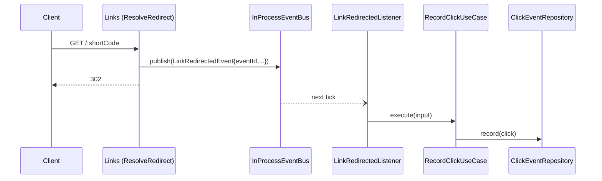

# Analytics — Implementation Plan

Status: planned. Owner module: `analytics`.

The `analytics` module records a click for every successful redirect and
serves per-link analytics to the link's owner. It learns about redirects only
through the `LinkRedirectedEvent` published by `links`. It never reads the
`links` table: ownership is checked through `links`' public `GetLinkUseCase`.

**Prerequisites:** [3-links.md](3-links.md) — `LinkRedirectedEvent`,
`GetLinkUseCase` (exported), `InProcessEventBus`, `PaginationQuery`,
`API_PREFIX`. [2-users-auth.md](2-users-auth.md) — `JwtAuthGuard`,
`@CurrentUser()`.

## 1. Scope

In scope:

- Subscribe to `LinkRedirectedEvent` → persist one `ClickEvent`
- `GET /api/v1/links/:id/analytics` — owner only, paginated:
  `{ totalClicks, lastClickedAt, clicks: { items, page, limit, total } }`
- `EventSubscriber` port in `shared/events`, so listeners don't depend on the
  concrete bus
- `eventId` on `LinkRedirectedEvent` for idempotent recording

Out of scope (known limitations): per-day or per-hour series, top referrers,
unique visitors, bot filtering, geography (AGENTS.md non-goal), retention or
cleanup of old clicks, guaranteed delivery (Transactional Outbox).

## 2. New dependencies

None. No new environment variables.

## 3. Persistence

```prisma
// Owned by the analytics module.
model ClickEvent {
  // = LinkRedirectedEvent.eventId, so a redelivered event can't double-count.
  id             String   @id @db.Uuid
  linkId         String   @map("link_id") @db.Uuid
  clickedAt      DateTime @map("clicked_at") @db.Timestamptz(3)
  // Origin only (https://news.example), never the full URL: paths and
  // query strings can carry personal data.
  referrerOrigin String?  @map("referrer_origin") @db.VarChar(255)
  userAgent      String?  @map("user_agent") @db.VarChar(512)

  link Link @relation(fields: [linkId], references: [id], onDelete: Cascade)

  @@index([linkId, clickedAt])
  @@map("click_events")
}
```

`Link` gets the back-relation `clickEvents ClickEvent[]`. As with
`links → users`, this is a schema-level foreign key only: analytics never
queries `links`.

- Migration: `add_click_events`. Use `migrate diff` + `migrate deploy` until
  the `init_users` checksum issue is resolved (see 3-links.md).
- `(link_id, clicked_at)` serves both the count and the newest-first page
  (AGENTS.md §6).
- `onDelete: Cascade`: deleting a link deletes its clicks. Analytics for a
  link nobody can open has no use, and keeping them would mean a dangling ID.
- No IP address column (AGENTS.md §5).

## 4. Module layout (`src/modules/analytics/`)

```text
domain/
  entities/click-event.entity.ts        ClickEvent { id, linkId, clickedAt, referrerOrigin, userAgent }
  repositories/click-event.repository.ts ClickEventRepository + CLICK_EVENT_REPOSITORY token
  value-objects/referrer-origin.vo.ts   header → origin or null (non-http(s) / malformed → null)
application/
  models/link-analytics.ts              { totalClicks, lastClickedAt, clicks: ClickPage }
  use-cases/record-click.use-case.ts
  use-cases/get-link-analytics.use-case.ts
infrastructure/
  persistence/prisma-click-event.repository.ts  P2002 → duplicate ignored; P2003 → link gone, ignored
interfaces/
  events/link-redirected.listener.ts    onModuleInit: subscribe(LinkRedirectedEvent → RecordClick)
  http/controllers/link-analytics.controller.ts  `${API_PREFIX}/links/:id/analytics`
  http/dto/link-analytics.response.ts
  http/dto/click.response.ts
analytics.module.ts                     imports AuthModule, LinksModule

shared/events/
  event-subscriber.ts                   EventSubscriber { subscribe(type, handler) } + EVENT_SUBSCRIBER
  (EventsModule binds EVENT_SUBSCRIBER → InProcessEventBus)

modules/links/application/events/link-redirected.event.ts
  + readonly eventId = randomUUID()
```

Contracts:

```ts
export interface ClickEventRepository {
  /** Idempotent: an existing id or a deleted link is a silent no-op. */
  record(click: ClickEvent): Promise<void>;
  summarize(linkId: string): Promise<{ totalClicks: number; lastClickedAt: Date | null }>;
  listByLink(linkId: string, page: PageRequest): Promise<ClickEvent[]>; // newest first
}

export interface EventSubscriber {
  subscribe<TEvent extends DomainEvent>(
    eventType: DomainEventType<TEvent>,
    handler: DomainEventHandler<TEvent>,
  ): void;
}
```

The listener lives in `interfaces/events`: it is to events what a controller
is to HTTP. It maps the event to a use-case input and contains no rules.

## 5. Use-case behavior

### RecordClick (event-driven)

Input: `{ eventId, linkId, occurredAt, referrer, userAgent }`

1. `ReferrerOrigin.from(referrer)`: parse with `URL.parse`. Keep the
   `origin` only for `http`/`https`; anything else becomes `null`.
2. Truncate `userAgent` to 512 characters (the column size). The redirect
   headers come from the client, so their size isn't trusted.
3. `repo.record({ id: eventId, linkId, clickedAt: occurredAt, ... })`.

| Case | Result |
|------|--------|
| New event | One row |
| Same `eventId` delivered twice | Still one row (`P2002` ignored) |
| Link deleted between redirect and insert | No row, no error log (`P2003` ignored) |
| Any other DB error | Thrown → the bus logs it; the redirect was already answered |

### GetLinkAnalytics

Input: `{ linkId, userId, page, limit }`

1. `getLinkUseCase.execute({ linkId, userId })` — `links` public API. Missing
   or foreign link → `LinkNotFoundError` → **404**, same body as `/links/:id`.
2. `summarize(linkId)` and `listByLink(linkId, page)` in parallel.

| Case | Result |
|------|--------|
| Owner | **200** `{ totalClicks, lastClickedAt, clicks: { items, page, limit, total } }` |
| No clicks yet | **200** with `totalClicks: 0`, `lastClickedAt: null`, `items: []` |
| Other user / unknown id | **404** |
| Bad UUID / bad page params | **400** |
| No token | **401** |

`clicks.total` equals `totalClicks`; the repository counts once.

## 6. Event flow



Delivery guarantee: **best-effort, at most once** in the MVP.

- A click is lost if the process stops between the 302 and the insert.
- Handler errors are logged, never retried.
- The `eventId` primary key makes recording idempotent, so moving to an
  at-least-once transport (outbox + worker, or a broker) won't double-count.

## 7. Input validation

| Field | Rules |
|-------|-------|
| `:id` | `ParseUUIDPipe` → 400 |
| `page`, `limit` | `PaginationQuery` (page 1–10000, limit 1–100) |
| `referrer` header | Stored as origin only; invalid → `null` |
| `user-agent` header | Truncated to 512 characters |

## 8. Security checklist

- [ ] Analytics route behind `JwtAuthGuard`; ownership via `GetLinkUseCase`
- [ ] Other users' links answer 404, not 403
- [ ] No IP address stored; referrer reduced to its origin
- [ ] Header values size-bounded before insert
- [ ] Analytics failures never change link state or the redirect response

## 9. Tests

**Unit** (no DB):

- `ReferrerOrigin` — full URL → origin; `android-app://`, malformed, empty,
  `null` → `null`
- `RecordClickUseCase` — maps the event; long user agent truncated
- `GetLinkAnalyticsUseCase` — not-owner propagates `LinkNotFoundError`
  without querying clicks; owner gets summary + page
- `LinkRedirectedListener` — subscribes on init; handler calls the use case
- `LinkRedirectedEvent` — each instance has a distinct `eventId`

**E2E** (`test/analytics.e2e-spec.ts`, real Postgres):

- Redirect twice, then analytics shows `totalClicks: 2`, newest first, with
  the referrer reduced to its origin
- New link → zero clicks
- Other user → 404 · no token → 401 · bad UUID → 400
- Inactive or unknown code → no click recorded
- Deleting the link deletes its clicks (via `PrismaService` count)
- Pagination of clicks

Recording happens on the next tick, so the e2e polls the analytics endpoint
with a short timeout instead of a fixed sleep.

**Repository / idempotency** (e2e or integration against the DB): recording
the same `eventId` twice gives one row, and recording for a deleted link
does not throw.

## 10. Implementation order

1. `eventId` on `LinkRedirectedEvent` (+ unit test).
2. `EventSubscriber` port + binding in `EventsModule`.
3. `ClickEvent` model + `add_click_events` migration.
4. Domain → application (+ unit tests) → infrastructure → interfaces.
5. Register `AnalyticsModule` in `AppModule`.
6. E2E tests; Swagger (`@ApiBearerAuth`, 200/401/404).
7. Update README when it is rewritten (delivery guarantee, endpoint).
8. Review loop: tech-lead agent review → developer agent fixes.

## 11. Verification

```bash
npx prisma migrate deploy
npx prisma generate
npm run lint && npm run build
npm test
npm run test:e2e
```

Manual check: create a link, open `http://localhost:3000/<code>` twice, then
`GET /api/v1/links/<id>/analytics` in `/api/docs` and expect `totalClicks: 2`.
